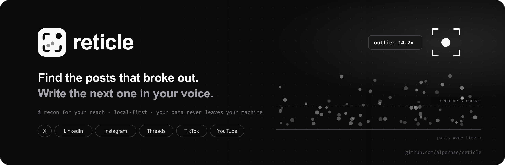
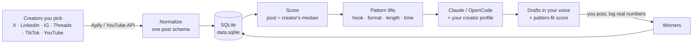

<div align="center">

<a href="https://github.com/alpernae/reticle"></a>

<br />
<br />

**Recon for your reach.** A private, local-first dashboard that finds the posts that out-performed their creator's normal,<br />
works out *why* they won, and drafts your next post in your own voice.

<b><a href="https://github.com/alpernae/reticle">Repository</a></b> ·
<a href="https://github.com/alpernae/reticle/issues/new">Report a bug</a> ·
<a href="https://github.com/alpernae/reticle/issues">Request a feature</a> ·
<a href="https://github.com/alpernae/reticle/releases">Releases</a>

<br />

[](https://github.com/alpernae/reticle/stargazers)
[](https://github.com/alpernae/reticle/network/members)
[](https://github.com/alpernae/reticle/watchers)
[](https://github.com/alpernae/reticle/issues)
[](LICENSE)

[](https://github.com/alpernae/reticle/commits)
[](https://github.com/alpernae/reticle/pulse)
[](https://github.com/alpernae/reticle)
[](https://github.com/alpernae/reticle)
[](https://github.com/alpernae/reticle/graphs/contributors)


[Features](#-features) ·
[How it works](#-how-it-works) ·
[Quick start](#-quick-start) ·
[Configuration](#%EF%B8%8F-configuration) ·
[Pages](#-pages) ·
[Scoring](#-how-drafts-are-judged) ·
[Costs](#-collectors--costs) ·
[FAQ](#-faq)

</div>

---

## 🎯 What is this?

Most "what should I post?" tools rank posts by raw likes, which mostly tells you who already has a big audience. **Reticle ranks posts by how much they beat their own creator's normal.** A 400-like post from an account that usually gets 20 is a signal; a 4,000-like post from an account that always gets 4,000 is noise.

It's built for one person, a solo creator (for example a developer or security researcher who builds in public) who wants to grow on X, LinkedIn, Instagram, Threads, TikTok and YouTube without becoming a full-time content person. You describe yourself once in **Settings → Creator profile**, and every draft is written as that person. It runs on your machine, stores everything in one SQLite file, and uses **your** Claude subscription (or API key) to write.

> [!NOTE]
> Reticle is a private tool, not a SaaS. There are no accounts on someone else's server, no telemetry and no shared database. Your collected posts, drafts, keys and numbers stay in `data.sqlite` on your disk.

## ✨ Features

<table>
<tr>
<td width="50%" valign="top">

### 🔭 Recon
- **Outlier detection**: every post scored against its creator's median (or engagement per follower for one-off authors)
- **Pattern lifts** per platform: hook type, format, length, hashtags, emoji, links, posting time
- **Recycled posts**: the same text posted again, and whether repeats still win
- **Best time to post**: windows ranked by outlier lift, shown in the audience's time *and* yours
- **Where posts come from**: an interactive globe of author locations with per-region timing

</td>
<td width="50%" valign="top">

### ✍️ Writing
- **Generate**: 3 drafts that borrow a winner's *structure* (never its text), in your voice
- **Toolkit**: bios, pinned posts, hooks, ideas, captions, threads and Threads chains, titles, descriptions, scripts, replies, repurposing
- **Visual designers**: YouTube thumbnails, Reel covers, carousels, banners and quote cards, exported as PNG at exact platform sizes
- **Platform limits enforced**: X counts the way X counts (280), Threads 500, LinkedIn 3,000…

</td>
</tr>
<tr>
<td valign="top">

### 🤖 AI that you control
- Claude CLI (your Pro/Max plan), Claude API, or local **OpenCode** models as fallback
- Model picker with favorites, per-run pinning and live quota status
- Layered system prompts you can edit: creator profile + platform playbook + format + role
- **Activity** log: every AI run drawn as a step-by-step pipeline, with model, duration and a reopenable result
- **Automations**: chain workers (Generate, Toolkit, agents, custom prompts, collectors) and run them on a schedule
- **Mind maps** with “Expand with AI”, a **Ctrl+K command menu**, and an **Ask** box for questions about your data

</td>
<td valign="top">

### 🔐 Local-first
- One SQLite file, no external database, no telemetry
- Single owner account, scrypt-hashed, httpOnly session cookie
- Keys stored locally and only sent to their own provider
- Hard **Apify spend limit** checked before every run
- One-command Docker deploy with a persistent volume

</td>
</tr>
</table>

### Supported platforms

| Platform | Collect | Generate | Toolkit | Collector |
|---|:-:|:-:|:-:|---|
| **X / Twitter** | ✅ | ✅ | ✅ | rotating handles, per-account deep scan, topic scan across all of X |
| **LinkedIn** | ✅ | ✅ | ✅ | one profile per run, rotating |
| **Instagram** | ✅ | ✅ | ✅ | posts + Reels per profile |
| **Threads** | ✅ | ✅ | ✅ | accounts (rotating) or `#tag` / phrase search |
| **TikTok** | ✅ | ✅ | — | profile videos, no downloads |
| **YouTube** | ✅ | ✅ | ✅ | free Data API key, Apify as fallback |

## 🧠 How it works



1. **Collect.** You list the creators worth learning from. Collectors run on *your* Apify account (or the free YouTube Data API) and every result is normalized into one schema: author, followers, location, likes, comments, shares, saves, views, format, hashtags and full text.
2. **Score.** Each post gets an **outlier ×**: its weighted engagement (comments ×2, shares ×3, saves ×2) divided by its creator's median. Posts at 2× or more are *winners*.
3. **Learn.** Winners are fingerprinted (hook type, format, length, emoji, hashtags, link, posting hour) and compared with the median, per platform, to get **pattern lifts**. Only traits seen in at least 5 posts count.
4. **Write.** The AI gets your creator profile, the platform playbook, the format rules, the strongest lifts and the top winner cards, and writes drafts that rebuild that structure around *your* material.
5. **Verify.** Every draft gets a **pattern-fit score** with the evidence behind it. After you post, you log the real numbers on Winners, and they feed back in.

## 🚀 Quick start

### Requirements

- **Node.js 24+** (uses the built-in `node:sqlite`, no native modules)
- One AI provider: a Claude Pro/Max plan with [Claude Code](https://docs.anthropic.com/en/docs/claude-code), a Claude API key, or a local [OpenCode](https://opencode.ai) install
- Optional: an [Apify](https://apify.com) account ($5/month free credit) and a free YouTube Data API key to collect posts

### Run locally

```bash
git clone https://github.com/alpernae/reticle.git
cd reticle
npm install
npm run dev
```

Open **http://localhost:3000**. The first visit creates the single owner account.

For a production build:

```bash
npm run build
npm start
```

### Run with Docker

```bash
docker compose up -d --build
```

Open **http://localhost:3000**. The database lives in the `payload-data` volume at `/data/data.sqlite` (the volume keeps the project's original name so existing installs keep their data).

Bring an existing local database along:

```bash
docker compose cp ./data.sqlite reticle:/data/data.sqlite
docker compose restart reticle
```

The image includes the Claude CLI, authenticated with the long-lived token you save on **Settings → AI providers** (made with `claude setup-token`). To build without it:

```bash
docker compose build --build-arg INSTALL_CLAUDE_CLI=false
```

### First-run checklist

1. **Settings → AI providers**: connect Claude (CLI token or API key) or let OpenCode run in Auto mode.
2. **Settings → Creator profile**: your identity, pillars, audience, voice, goals and a "never do" list. Every AI call writes as this person.
3. **Sources**: paste your Apify token, set a **spend limit**, and list 8–15 creators per platform. Mix big names with smaller accounts that are rising.
4. Run a collector, then open **Overview** and **Winners & patterns**.
5. **Generate** your first drafts, post one, and log its real numbers on **Winners**.

## ⚙️ Configuration

Almost everything is set in the app (Settings and Sources) and stored in SQLite. Environment variables are only for deployment:

| Variable | Default | What it does |
|---|---|---|
| `DATA_DIR` | project folder | Where `data.sqlite` lives (Docker uses `/data`) |
| `PORT` | `3000` | HTTP port |
| `PAYLOAD_OPENCODE_AUTOSTART` | `true` | Set `false` to stop Reticle from starting the local OpenCode service on boot |
| `OPENCODE_BIN` | auto-detected | Path to a specific `opencode` executable |
| `CLAUDE_CODE_OAUTH_TOKEN` | — | Optional alternative to saving the Claude token on Settings |

### AI providers

The first available provider wins, unless you pin one for a run.

1. **Claude CLI**: your Claude Pro/Max subscription through Claude Code. Install with `npm i -g @anthropic-ai/claude-code` and sign in with `claude` → `/login`, or save a `claude setup-token` token on Settings.
2. **Claude API**: an API key from console.anthropic.com (Opus, Sonnet or Haiku).
3. **OpenCode**: local OpenCode service, used as the fallback. On every server start Reticle switches it to Auto mode and starts it in the background (`instrumentation.ts` → `lib/startup.ts`). On Windows it launches the native `opencode.exe` behind the npm shim.

Every AI call is built from layers (`lib/playbook.ts`, editable on **Settings → Playbook**): your **creator profile**, then the **platform playbook**, your per-platform **voice note**, the **format** (single post, thread, poll, carousel, Reel, Short…) and finally a **specialist role** for the tool. The Settings preview shows the exact composed prompt.

## 🗺️ Pages

| Page | What it does |
|---|---|
| **Overview** | Post-origin globe, KPIs, topic spikes, **best time to post**, AI brief, platform and category filters |
| **Winners & patterns** | Posts ranked by outlier ×, pattern lifts per platform, recycled posts, "Sort with Claude" for uncategorized posts |
| **Recommendations** | Ranked winners with why they won and how to adapt them |
| **Feed** | Every collected post with author, followers, format and metrics |
| **Generate** | 3 drafts that borrow a winner's structure; pick platform, format, tone and model |
| **Toolkit** | Per-platform tools for Instagram, Threads, X, LinkedIn and YouTube, plus visual designers with PNG export |
| **Formats** | Series trackers ("Day N/365" logs: you type the numbers, AI never touches them) and quick posts: polls, hot takes, ask-the-crowd, **mini code challenges with code images** |
| **Workflows** | Multi-step background jobs: topic deep-dive, hook hunter, weekly calendar, winners autopsy |
| **Automations** | Chains of up to 6 steps (Generate, Toolkit, agents, custom prompts, collectors) with your prompts and platforms, run by hand or on a schedule: once, daily, weekly or every N hours |
| **Mind maps** | Drag-and-connect idea maps with AI expansion and “write a post from this” |
| **Activity** | Every AI run as a pipeline: live status, steps, model, duration, full result, cancel, reopen |
| **Ctrl+K · Ask** | A command menu for every page, tool and action; an Ask box (bottom-right, or press `/`) that answers questions from your data |
| **Results / Winners** | Your drafts and the real numbers you log after posting |
| **Sources** | Collectors, spend limit, run history, re-process past runs |
| **Settings** | AI providers and models, creator profile, playbook, keys, local data facts |

## 📏 How drafts are judged

There's no way to know a post will work before it's posted, so Reticle is explicit about what it *can* measure:

| Signal | What it is | Trust it for |
|---|---|---|
| **Outlier ×** | Weighted engagement ÷ the creator's own median | Which posts actually broke out |
| **Pattern lift** | How posts with a trait did vs the median, per platform (n ≥ 5) | Which structures tend to win |
| **Pattern-fit** | Each draft fingerprinted and matched against the lifts (geometric mean, small samples shrunk toward 1×) | Structure, not topic quality |
| **Measured hashtags** | Hashtags seen in your data with n and median outlier | Tags with evidence; anything else is marked unverified |
| **Design checks** | Word count, contrast ratio, highlight, handle | Best-practice rules (image performance isn't measured) |
| **Your logged numbers** | What really happened after you posted | The final verdict |

## 💸 Collectors & costs

All collectors run on **your own Apify account**. One spend limit covers every collector and scan, checked against your Apify usage for the current billing cycle before any run starts. Each platform shows its actor's real price and the most a run can cost.

| Platform | Default actor | Notes |
|---|---|---|
| X | `apidojo/tweet-scraper` · `kaitoeasyapi/…-cheapest` | Rotating handle chunks; deep and topic scans at about $0.25 / 1k tweets |
| LinkedIn | `apimaestro/linkedin-profile-posts` | One profile per run, rotates through your list |
| Instagram | `apify/instagram-scraper` | Run budget split across profiles; skips posts older than 45 days |
| Threads | `futurizerush/meta-threads-scraper` | About $2.50 / 1k posts; at least 10 posts per account, accounts rotate between runs |
| TikTok | `clockworks/tiktok-scraper` | No video downloads |
| YouTube | YouTube Data API (free) · `streamers/youtube-scraper` | 10k free units/day ≈ 3 units per channel |

You can swap any actor on the Sources page. Mappers are defensive, so changed output shapes degrade to missing fields instead of crashes.

## 🏗️ Tech stack

| Layer | Choice | Why |
|---|---|---|
| Framework | **Next.js 16** (App Router, Turbopack, `cacheComponents`) | Server routes and UI in one process |
| UI | **PanelUI** + Base UI + Tailwind CSS 4 | Monochrome, keyboard-friendly, dark and light |
| Database | **SQLite** via `node:sqlite` (WAL) | One file, no server, back up with a copy |
| AI | Claude CLI / Claude API / OpenCode | Your subscription first, local fallback |
| Collectors | Apify Run API, YouTube Data API | Pay-per-result, your own account |

<details>
<summary><b>Project structure</b></summary>

```text
app/                 pages (App Router) and API routes (app/api/*)
  page.tsx           Overview
  generate/ toolkit/ formats/ workflows/ patterns/ feed/ sources/ settings/ …
components/          app components (panel shell, model picker, best time, planet…)
  panelui/           PanelUI components (planet, usage, toast, select…)
lib/
  db.ts              SQLite schema + lazy migrations
  normalize.ts       one post shape for every platform
  apify.ts           collectors, cost guards, spend limit
  engine.ts          classification, scoring, payloads
  patterns.ts        outlier score + pattern lifts
  playbook.ts        layered system prompts
  besttime.ts geo.ts timing windows and post-origin geocoding
  limits.ts          platform character limits (X-style counting)
.github/assets/      banner and logo
```

</details>

<details>
<summary><b>Why SQLite and not Postgres / Supabase?</b></summary>

Single user, local-first, low write volume. SQLite is one file, needs no server, backs up with a copy and fits a single Docker volume. Postgres or Supabase only pay off for multiple users, remote access or multi-device sync, and none of those are goals here.

</details>

## ❓ FAQ

<details>
<summary><b>Does it post for me?</b></summary>

No. Reticle drafts and you post. That keeps your accounts safe from automation rules, and the numbers you log afterwards stay honest.

</details>

<details>
<summary><b>Can it see impressions by country or my private analytics?</b></summary>

No. Public scrapes return public counts: likes, comments, reposts and usually views. Private analytics need the platform's own export; log those numbers on **Winners**.

</details>

<details>
<summary><b>Does it copy other people's posts?</b></summary>

No. Drafts borrow *structure* (hook type, format, rhythm) from winners and are written around your own ideas. The prompts forbid reusing text.

</details>

<details>
<summary><b>How much does it cost to run?</b></summary>

The app is free. AI uses your Claude plan or local OpenCode models. Collecting costs whatever your Apify actors charge (a few cents per run with the defaults), capped by the spend limit you set. YouTube can use the free Data API.

</details>

## ⭐ Star history

<a href="https://star-history.com/#alpernae/reticle&Date">
  <picture>
    <source media="(prefers-color-scheme: dark)" srcset="https://api.star-history.com/svg?repos=alpernae/reticle&type=Date&theme=dark" />
    
  </picture>
</a>

## 🤝 Contributing

Issues and pull requests are welcome.

1. [Fork the repo](https://github.com/alpernae/reticle/fork) and create a branch: `git checkout -b my-change`
2. Make your change. Keep it local-first (no new external services without a toggle) and keep secrets out of the repo.
3. Check it compiles: `npx tsc --noEmit`
4. [Open a pull request](https://github.com/alpernae/reticle/pulls) describing what changed and why.

Found a bug or have an idea? [Open an issue](https://github.com/alpernae/reticle/issues/new).

## 📄 License

[MIT](LICENSE) © 2026 [alpernae](https://github.com/alpernae)

<div align="center">
<br />

<br />
<sub><b>reticle</b> · recon for your reach</sub>
</div>
